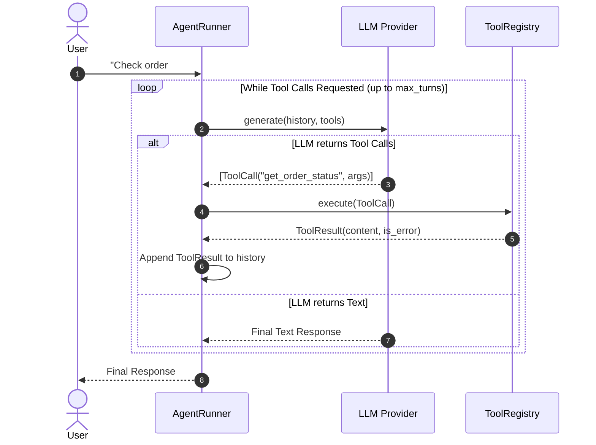

## The Hidden Complexity of Tool Calling

In theory, LLM tool calling is straightforward:
1. Provide the model with a list of function descriptions formatted in JSON Schema.
2. The model returns a structured JSON payload naming the function and arguments.
3. Your application executes the function and returns the result.

In practice, without a disciplined runtime engine, tool calling quickly degrades into a mess of:
- **Manual JSON Schema drift**: Writing JSON Schemas by hand that fall out of sync with your actual Python code signatures.
- **Untyped argument handling**: Models passing strings where integers were expected, or omitting default values.
- **Unhandled exceptions**: A single database failure crashes the entire agent loop.

In this post, we’ll break down how we built a **zero-dependency `ToolRegistry`** that generates standard JSON Schemas from Python type hints and docstrings, coupled with a resilient execution runtime.

---

## 🛠️ Step 1: Automatic Schema Introspection with `@tool`

We wanted our tools to look like standard Python functions. No bespoke base classes, no boilerplate.

```python
@tool
def get_order_status(order_id: str, email: str) -> dict[str, Any]:
    """Look up order status, fulfillment details, and carrier tracking by Order ID and email."""
    # Real business logic
```

Behind the scenes, our `ToolRegistry` inspects Python's standard `inspect` and `typing` modules to dynamically construct the JSON Schema:

```python
def _python_type_to_json_schema(py_type: Any) -> dict[str, Any]:
    if py_type in (str,):
        return {"type": "string"}
    elif py_type in (int,):
        return {"type": "integer"}
    elif py_type in (float,):
        return {"type": "number"}
    elif py_type in (bool,):
        return {"type": "boolean"}
    elif py_type in (list,):
        return {"type": "array"}
    elif py_type in (dict,):
        return {"type": "object"}
    return {"type": "string"}
```

### Distinguishing Required vs. Optional Parameters
A common bug in home-grown agent runtimes is marking *all* arguments as required, even when Python functions provide default values. 

Our registry inspects parameter defaults using `inspect.Parameter.empty`:

```python
sig = inspect.signature(func)
for param_name, param in sig.parameters.items():
    if param.default is inspect.Parameter.empty:
        required.append(param_name)
```

If a parameter has a default (e.g. `reason: str = ""`), it is omitted from `required`, allowing the LLM to call the tool cleanly without hallucinating dummy default parameters.

---

## 🔄 Step 2: The Multi-Turn ReAct Execution Loop

Once tools are registered, the `AgentRunner` orchestrates the multi-turn conversational loop:



### The Turn Loop Implementation
Here is the core loop from `core/engine.py`:

```python
while turn_count < max_turns:
    turn_count += 1
    tool_definitions = self.registry.get_definitions()

    response: ModelResponse = self.provider.generate(
        messages=self.history,
        tools=tool_definitions if tool_definitions else None,
        system_instruction=self.system_instruction,
        temperature=temperature,
    )

    if response.has_tool_calls:
        # Append assistant turn with tool calls
        self.history.append(
            Message.assistant(content=response.content, tool_calls=response.tool_calls)
        )

        # Execute each tool and collect results
        tool_results = []
        for tc in response.tool_calls:
            result = self.registry.execute(tc)
            tool_results.append(result)

        # Consolidate all tool results into a single turn
        self.history.append(Message.from_tool_results(tool_results))
        continue

    # Terminal text response reached
    self.history.append(Message.assistant(content=response.content or ""))
    return AgentResult(
        final_response=response.content or "",
        turn_count=turn_count,
        tool_calls_executed=executed_tool_calls,
        total_tokens=accumulated_tokens,
    )
```

---

## 🛡️ Step 3: Zero Uncaught Exceptions Invariant

What happens when an external API fails, or the model sends malformed arguments?

If an unhandled exception bubbles up and kills the Python process, your web server drops the connection and the user sees a blank screen.

In our harness, `ToolRegistry.execute()` wraps every execution in a fail-safe try/catch block:

```python
try:
    result = tool_func(**tool_call.arguments)
    return ToolResult(call_id=tool_call.id, name=tool_call.name, content=json.dumps(result))
except Exception as e:
    return ToolResult(
        call_id=tool_call.id,
        name=tool_call.name,
        content=f"Error executing tool '{tool_call.name}': {type(e).__name__}: {str(e)}",
        is_error=True,
    )
```

Because `is_error=True` is returned as a regular message to the model, the model can self-correct:
> *"I apologize, but I could not look up that order because the email address didn't match our records. Could you please double check your email?"*

---

## 🧹 Step 4: Context Window Hygiene & Pruning

As conversations progress, keeping every past message quickly exhausts model context limits and drives up cost.

Our runner includes automated sliding-window compaction:

```python
def _prune_history_if_needed(self) -> None:
    if len(self.history) > self.max_history_messages:
        excess = len(self.history) - self.max_history_messages
        self.history = self.history[excess:]
        # Invariant: The oldest surviving message must always be a user turn
        while self.history and self.history[0].role != Role.USER:
            self.history.pop(0)
```

This ensures the prompt cache remains warm, the context stays bounded, and turn alternation invariants are never broken.

---

## 💡 Summary

By separating schema generation (`core/registry.py`) from execution orchestration (`core/engine.py`), we achieved:
* 100% type-safe tool declarations using standard Python decorators.
* Graceful, non-crashing recovery from runtime errors.
* Predictable, bounded context memory.
