## The Blindness of Traditional Logging in AI

In traditional web microservices, diagnosing performance is well understood: inspect HTTP response codes, trace database queries, and follow request IDs.

With autonomous AI agents, standard logging breaks down:
* A request took 4.8 seconds. Why? Was the LLM reasoning slowly? Did a weather API timeout? Or did the agent get caught in a 3-turn tool retry loop?
* Which specific customer sessions are driving up your OpenAI/Gemini token bill?
* How many times did your model attempt an invalid tool argument before succeeding?

If your answer is *"we search through CloudWatch or Datadog text logs,"* you are flying completely blind.

In this post, we’ll demonstrate how to instrument an agent harness with **OpenTelemetry (OTel)** using the official **GenAI Semantic Conventions** (`gen_ai.*`), producing nested distributed tracing waterfalls.

---

## 🏛️ The Distributed Span Hierarchy

A single user message to an agent is rarely a single API call. It is a parent workflow with multiple child operations.

Our OpenTelemetry listener structures traces into a strict hierarchical tree:

```
agent.turn (Root Span: 3,294ms)
 ├── gen_ai.generate (Gemini 2.5 Flash: 1,420ms)
 │    ├── gen_ai.system: "gemini"
 │    ├── gen_ai.request.model: "gemini-2.5-flash"
 │    └── gen_ai.usage.total_tokens: 2,398
 ├── tool.get_order_status (Postgres OMS Mock: 84ms)
 │    ├── tool.name: "get_order_status"
 │    ├── tool.args.order_id: "#NG-84920"
 │    └── status: OK
 └── gen_ai.generate (Gemini 2.5 Flash: 1,790ms)
      ├── gen_ai.usage.total_tokens: 2,452
      └── status: OK
```

When visualized in Jaeger, Honeycomb, or Datadog, this gives your team an **instant latency waterfall**:

```mermaid
gantt
    title Agent Execution Waterfall (Jaeger Trace)
    dateFormat X
    axisFormat %s ms
    section Root
    agent.turn           : 0, 3294
    section Child 1 (LLM)
    gen_ai.generate #1   : 20, 1440
    section Child 2 (Tool)
    tool.get_order_status: 1445, 1529
    section Child 3 (LLM)
    gen_ai.generate #2   : 1535, 3280
```



---

## 🛠️ Implementing `OpenTelemetryListener`

Because we implemented an event-driven lifecycle bus in Part 5, adding OTel required **zero changes** to our runner engine or tool logic.

We simply wrote an `OpenTelemetryListener` in `providers/telemetry/otel.py` that translates lifecycle events into OTel spans:

```python
class OpenTelemetryListener:
    def __init__(self, tracer: Tracer | None = None) -> None:
        self.tracer = tracer or trace.get_tracer("agent-harness")
        self._root_spans: dict[str, Any] = {}
        self._llm_spans: dict[str, Any] = {}
        self._tool_spans: dict[str, Any] = {}

    def on_turn_start(self, event: TurnStartEvent) -> None:
        span = self.tracer.start_span("agent.turn")
        span.set_attribute("session.id", event.session_id)
        span.set_attribute("gen_ai.prompt", event.user_prompt)
        self._root_spans[event.session_id] = span

    def on_llm_request(self, event: LLMRequestEvent) -> None:
        root_span = self._root_spans.get(event.session_id)
        ctx = trace.set_span_in_context(root_span) if root_span else None

        span = self.tracer.start_span("gen_ai.generate", context=ctx)
        span.set_attribute("gen_ai.system", "gemini")
        span.set_attribute("gen_ai.request.model", event.model)
        self._llm_spans[event.session_id] = span

    def on_llm_response(self, event: LLMResponseEvent) -> None:
        span = self._llm_spans.pop(event.session_id, None)
        if span:
            span.set_attribute("gen_ai.usage.prompt_tokens", event.usage.prompt_tokens)
            span.set_attribute("gen_ai.usage.completion_tokens", event.usage.completion_tokens)
            span.set_attribute("gen_ai.usage.total_tokens", event.usage.total_tokens)
            span.end()

    def on_tool_start(self, event: ToolStartEvent) -> None:
        root_span = self._root_spans.get(event.session_id)
        ctx = trace.set_span_in_context(root_span) if root_span else None

        span = self.tracer.start_span(f"tool.{event.tool_name}", context=ctx)
        span.set_attribute("tool.name", event.tool_name)
        span.set_attribute("tool.call_id", event.call_id)
        self._tool_spans[event.call_id] = span

    def on_tool_end(self, event: ToolEndEvent) -> None:
        span = self._tool_spans.pop(event.call_id, None)
        if span:
            if event.is_error:
                span.set_status(Status(StatusCode.ERROR, description=event.output_preview))
            else:
                span.set_status(Status(StatusCode.OK))
            span.end()
```

---

## 🔍 Instant Trace Debugging with Docker & Jaeger

We pre-configured our repository's `docker-compose.yml` with a lightweight, local **Jaeger All-in-One** tracing collector:

```yaml
services:
  agent-api:
    build: .
    ports: ["8000:8000"]
    environment:
      - OTEL_EXPORTER_OTLP_ENDPOINT=http://jaeger:4318

  jaeger:
    image: jaegertracing/all-in-one:1.57
    ports:
      - "16686:16686" # Web UI
      - "4318:4318"   # OTel HTTP collector
```

Run one command:
```bash
docker compose up
```
Open `http://localhost:16686` in your browser. Every chat interaction in NovaGear now renders interactive waterfalls displaying exact token breakdowns and function timings.

---

## 💡 Lessons for Production Deployments

1. **Adopt OpenTelemetry GenAI Semantic Conventions early.** Using standardized attribute names (`gen_ai.usage.total_tokens`, `gen_ai.request.model`) prevents vendor lock-in to proprietary tracing tools like LangSmith or Arize.
2. **Propagate Context Across Turns.** Storing the root span in the session context allows distributed traces to link multi-step agent actions into a cohesive customer journey.
3. **Set Span Errors on Tool Failures.** Marking tool execution spans with `StatusCode.ERROR` lets monitoring alerts trigger when backend APIs begin rejecting agent calls.
