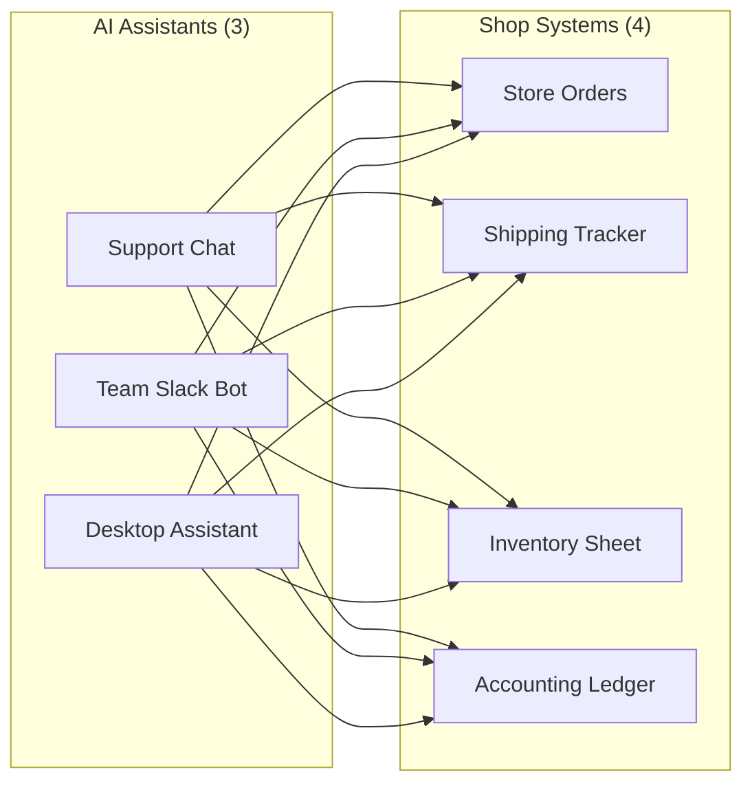
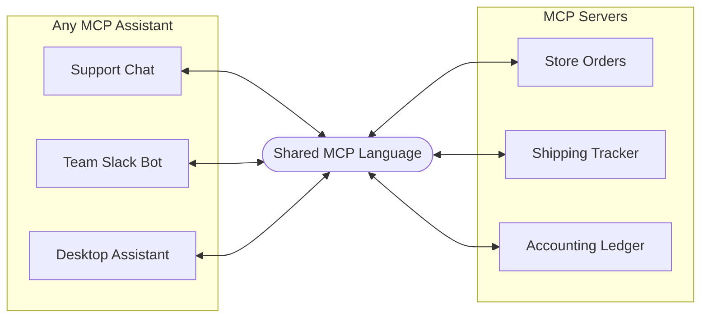
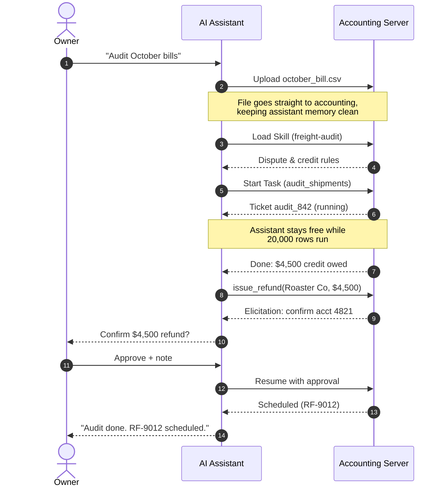

If you search *what is MCP*, most answers hit you with protocol jargon right away: JSON-RPC, transports, primitives, and schemas.

Here is a simpler way to think about it.

Imagine you hire a capable new assistant to help run an online coffee shop. They read fast, spot billing errors quickly, and write clear emails. There is just one problem. On their first day, they sit at an empty desk with no logins. They cannot look up an order, check shipping status, or open your accounting ledger unless you connect them to those systems.

**MCP (Model Context Protocol)** is the open standard that lets AI assistants connect to external tools, data, and files in a consistent way.

To see why MCP exists and why it recently changed so much, follow that same new assistant through three stages: **Before MCP**, **MCP v1**, and **MCP v2**.

## Before MCP: Hiring a custom translator for every pair

Before MCP, connecting an AI assistant to your software worked like hiring private translators for every single conversation.

Suppose your shop uses AI in three places: a customer support chat, a Slack bot for your team, and a desktop assistant you use for bookkeeping. Behind the scenes, your business runs on four systems: store orders, a shipping tracker, an inventory sheet, and an accounting ledger.

Each AI app formatted tool calls its own way. Each internal system expected different inputs and authentication. Because nobody shared a common language, engineers had to build and maintain `3 × 4 = 12` separate translators by hand, one for every assistant and system pair.

This created obvious friction:

* **Adding one tool meant wiring it everywhere.** Connect a new warehouse app, and you had to write three new translators for your three AI apps.
* **Company rules were duplicated.** Your refund guidelines lived inside separate prompts in Slack, support chat, and the desktop app, drifting out of sync over time.
* **Nothing carried over.** If you switched to a better AI assistant later, you threw away the old wiring and built it again.

## MCP v1: Everyone learns one common language

MCP v1 solved the translator problem by getting both sides to speak the same language.

Instead of writing custom bridges for every app, you teach your Store Orders system to speak MCP once. You teach your Shipping Tracker to speak MCP once. You teach your Accounting Ledger to speak MCP once. Any assistant that understands MCP can walk in on day one and talk to all of them.

Twelve custom translators collapsed into seven shared connections (`N + M` instead of `N × M`).

### Where a shared language still fell short

Teaching your assistant and your tools the same vocabulary got them talking. For quick lookups like *"Where is order 4812?"*, MCP v1 worked great.

As soon as your assistant tried to handle normal daily work, four practical problems showed up:

1. **Knowing the words is not knowing the job.**
   Your assistant could now see 40 actions (`issue_refund`, `create_store_credit`, `void_invoice`), but the shared language never explained your shop rules. When a customer got a crushed bag of espresso, should the assistant refund the card, ship a free bag, or issue store credit? Either you pasted your whole employee handbook into every chat, crowding the assistant's memory, or it guessed.

2. **Waiting on hold froze the whole desk.**
   Suppose you asked the assistant to compare 20,000 shipping labels from last quarter against a carrier invoice. Under MCP v1, the assistant had to stay on the line until the entire job finished. You could not ask anything else while it waited, and slow jobs often timed out halfway through.

3. **No pause to ask before moving money.**
   Imagine the assistant spots an overcharge and prepares a $4,500 wholesale refund. In v1, the tool had only two outcomes: run immediately with zero check, or fail with an error. The assistant could not pause halfway through and ask you, *"Wait, should I send $4,500 to Roaster Co. ending in 4821?"*

4. **Reading spreadsheets aloud over the phone.**
   When a shipping carrier sent a 15 MB CSV bill or a long PDF contract, there was no clean way to hand that file straight to the accounting system. Teams ended up pasting giant blocks of raw file text into the chat itself, wasting memory and hurting accuracy.

## MCP v2: From speaking the language to working like a teammate

MCP v2 keeps the same shared language from v1 and adds the four everyday habits that turn a basic tool connection into a reliable working relationship.

### 1. Pocket checklists instead of the whole handbook (Skills)

In MCP v2, each system can keep short checklists alongside its tools.

Instead of reading every shop policy at the start of every chat, your assistant sees a small index of available guides. When a damaged package message arrives, it pulls only the **"Damaged Order Policy"** checklist, follows your rules, and moves on. When you update your refund threshold from $40 to $60 on the server, every connected assistant picks up the new rule automatically.

### 2. Hanging up and getting a call back (Tasks)

When you ask for that 20,000 row shipping audit under MCP v2, the accounting system no longer keeps your assistant stuck on hold.

It accepts the job, returns a ticket ID immediately, and runs the heavy work in the background as a **Task**. Your assistant stays free to answer other questions or check inventory, then picks up the finished audit report once the job wraps up.

### 3. Checking with you before hitting send (Elicitation)

With **Elicitation**, a system can pause an action midway and ask a person for confirmation or missing details before continuing.

Right before that $4,500 wholesale refund leaves your account, the accounting server pauses and puts a confirmation card on your screen asking you to verify the bank digits and add a quick note. Once you approve, the action finishes. The safety check lives in the protocol itself rather than hoping the AI remembers to ask.

### 4. Handing the folder straight to accounting (File Uploads)

Instead of making the AI read megabytes of CSV rows or PDF pages inside the chat window, **File Uploads** let the client send files directly to the server.

You drop the 15 MB carrier bill into the chat, the file goes straight to the accounting server built to parse spreadsheets, and your assistant receives only the short summary it needs: *"Found 3 overcharged shipments totaling $412."*

### All four habits in one workflow

Here is how that October shipping audit looks from start to finish under MCP v2:

## Comparing the three stages

| Stage | How systems connect | How rules are shared | Slow jobs | Risky actions | Large files |
| :--- | :--- | :--- | :--- | :--- | :--- |
| **Before MCP** | Custom translator per pair | Repeated in every app prompt | Custom timeouts | Built per app | Custom upload code |
| **MCP v1** | One shared language | Stuffed into tool schemas | Blocks until done | Runs blindly or errors | Pasted into chat text |
| **MCP v2** | One shared language | **Skills** loaded when needed | **Tasks** run in background | **Elicitation** asks first | Direct **File Uploads** |

## Summary

If someone asks you *what is MCP*, think of a new assistant joining your company:

* **Before MCP**, every assistant and every tool needed a custom translator.
* **MCP v1** gave everyone one shared language.
* **MCP v2** added the workplace habits (checklists on demand, background tasks, confirmation checks, and direct file handoffs) so an assistant can handle real operations safely.
